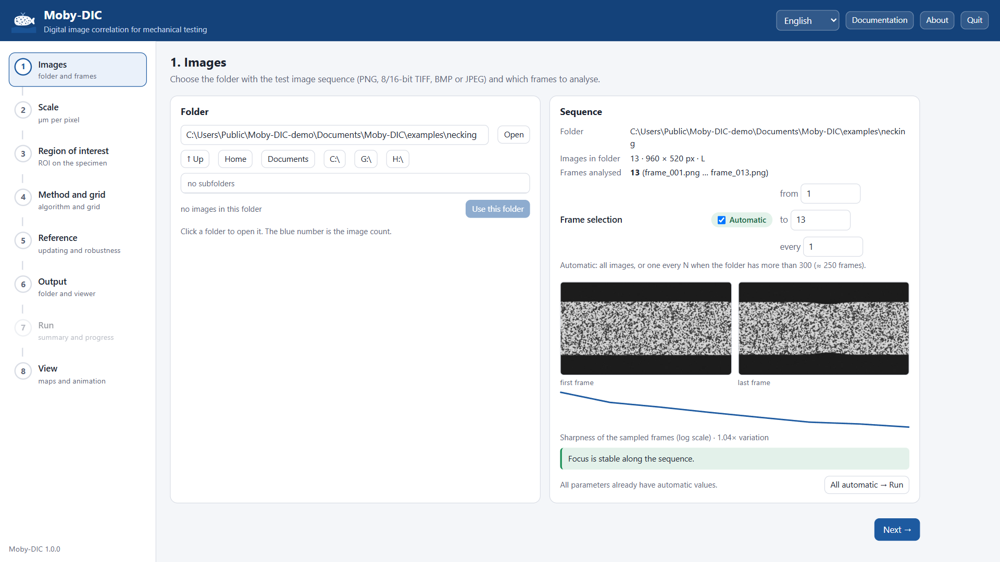

<p align="center"></p>

<h1 align="center">Moby-DIC</h1>

<p align="center"><b>2D digital image correlation for mechanical testing</b><br>
Correlação digital de imagens 2D para ensaios mecânicos</p>

<p align="center">
Version 1.0.0 · MIT License · Windows executable or Python 3.10+ · English / Português
</p>

[English](#english) · [Português](#português)

---

## English

Moby-DIC measures full-field **displacements and strains** on a specimen surface from the image
sequence of a mechanical test. A guided interface opens in your web browser, the analysis runs
locally on your computer, and every result comes with a self-contained interactive viewer that you
can share.



### Highlights

- **Guided workflow**: images → scale → region of interest → method and grid → reference → output
  → run → view. Every parameter has an **automatic** value derived from your images (specimen
  edges, speckle size, focus variation) that you can switch to manual.
- **Accurate, robust subset DIC**: IC-GN with ZNSSD, affine subsets, cubic B-spline
  interpolation, compiled parallel kernels. Automatic reference updating, rejection of false
  matches, lost-point recovery and rescue, rigid-jump detection and sharpness matching for
  refocused frames.
- **True strains** from local plane fitting, plus principal strains, maximum shear, von Mises
  equivalent strain, area change, contraction ratio, plastic anisotropy r, rotation,
  frame-to-frame increments and correlation quality.
- **Interactive viewer** in a single HTML file: 1/2/4 synchronised panels, 18 fields, 13 colormaps,
  adjustable scales, zoom, animation; export of figures (PNG), frame series (ZIP) and videos.
- **Open outputs**: NumPy archive and CSV tables of all fields, static figures, full parameter
  record for reproducibility.
- **Built-in example datasets** with exact solutions, used by the tutorials.
- Interface, messages and figures in **English or Portuguese** (asked on the first start).

### Get started

**Windows (no Python needed):** download and unzip `Moby-DIC-1.0.0-windows-x64.zip`, run
`Moby-DIC\Moby-DIC.exe`, choose your language, and click **Try an example**. The folder also
contains `Moby-DIC-tutorial.mp4`, a 4-minute narrated walkthrough.

**From source (Windows, Linux, macOS):**

```bash
python -m venv .venv
.venv/Scripts/python -m pip install -r requirements.txt      # Linux/macOS: .venv/bin/python
.venv/Scripts/python -m mobydic                              # opens the interface
```

### Documentation

The full documentation (user guide, viewer, output files, command line, theory, good experimental
practice, four tutorials, troubleshooting) is in [`docs/`](docs/index.md) and is opened by the
**Documentation** button of the program.

| | |
|---|---|
| [Installation](docs/installation.md) | executable, source, where files are stored |
| [Tutorial 1 · First analysis](docs/tutorials/01-first-analysis.md) | tension with necking, step by step |
| [User guide](docs/user-guide.md) · [Viewer](docs/viewer.md) | every option of the workflow and of the viewer |
| [Theory](docs/theory.md) | correlation, IC-GN, reference updating, strain computation, spatial resolution |
| [Command line and Python](docs/command-line.md) | batch processing and scripting |
| [Tutorials 2–4](docs/tutorials/02-layered-specimen.md) | heterogeneous specimens, difficult sequences, post-processing in Python |

### Command line

```bash
moby-dic subsets --images IMAGES --output RESULT --scale-um-px 1.76   # ROI and parameters automatic
moby-dic viewer RESULT --lang en                                      # build the viewer
moby-dic example necking                                              # synthetic example dataset
```

(`moby-dic` is `Moby-DIC.exe` or `python -m mobydic`.)

### Validation

`tests/test_sintetico.py` imposes known fields on synthetic speckle images: displacement error
0.011 px (std) and strain error 0.05 % for the correlation kernel; the full command-line workflow
recovers the imposed logarithmic strain to 10⁻⁶. The example datasets reproduce a 17.4 % neck peak
within 0.2 % strain and recover a 14 px rigid jump with 100 % of the points measured. Run
`python -m pytest tests`.

### Building

```bat
empacotamento\construir_exe.bat
```

builds the documentation, the executable (`dist\Moby-DIC\`) and the release ZIP. The video
tutorial and the documentation figures are regenerated by `docs/video/make_tutorial_video.py` and
`docs/tools/make_figures.py` (Playwright + Microsoft Edge).

### Project layout

```
mobydic/            the program: app.py (server) · web/app.html (interface) · subsets.py (DIC)
                    auto.py (automatic parameters) · export.py · viewer.py · exemplos.py · i18n.py
docs/               documentation sources (Markdown), figures, video and figure generators
tests/              synthetic accuracy tests
empacotamento/      executable packaging (PyInstaller) and icon
```

### License and citation

Moby-DIC is released under the [MIT License](LICENSE). Third-party components are listed in
[THIRD_PARTY_NOTICES.md](THIRD_PARTY_NOTICES.md). If Moby-DIC contributes to a publication, please
cite it as described in [CITATION.cff](CITATION.cff).

---

## Português

O Moby-DIC mede **deslocamentos e deformações** de campo completo na superfície de uma amostra a
partir da sequência de imagens de um ensaio mecânico. Uma interface guiada abre no navegador, a
análise roda no seu computador e cada resultado vem com um visualizador interativo autocontido,
que pode ser compartilhado.

- **Fluxo guiado** com valores **automáticos** para todos os parâmetros (bordas da amostra,
  tamanho do speckle, variação de foco), que podem virar manuais.
- **DIC por subsets** preciso e robusto: IC-GN, ZNSSD, subsets afins, interpolação B-spline cúbica,
  atualização automática da referência, rejeição de falsos casamentos, recuperação e resgate de
  pontos, detecção de saltos rígidos e igualação de nitidez.
- **Deformações verdadeiras** e grandezas derivadas; **visualizador** com 18 campos, 13 colormaps,
  zoom, animação e exportação de figuras, quadros e vídeos.
- Interface, mensagens e figuras em **português ou inglês** (escolhido no primeiro uso).

**Para começar no Windows:** descompacte `Moby-DIC-1.0.0-windows-x64.zip`, abra
`Moby-DIC\Moby-DIC.exe`, escolha o idioma e clique em **Experimentar um exemplo**. O vídeo
`Moby-DIC-tutorial.mp4` (em inglês) mostra uma análise completa em 4 minutos.

A documentação completa (em inglês) está em [`docs/`](docs/index.md) e abre pelo botão
**Documentação** do programa. Licença [MIT](LICENSE).
