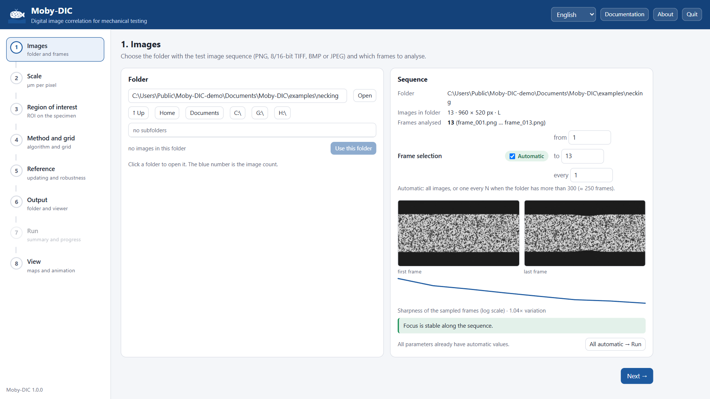

# Moby-DIC

**Moby-DIC** is a free, open-source program for **2D digital image correlation (DIC)**: it measures
full-field displacements and strains on the surface of a specimen from the sequence of images of a
mechanical test. It is designed so that the whole analysis can be run by someone who is not a DIC
specialist, while every choice stays visible and adjustable for those who are.

## What it does

- **Guided workflow** in your web browser: images → scale → region of interest → method and grid →
  reference → output → run → view. Every parameter has an **automatic** value derived from your
  images (speckle size, specimen edges, focus variation) that you can switch to manual.
- **Local subset DIC** (IC-GN, ZNSSD, affine subsets, cubic B-spline interpolation), compiled and
  parallel, with robust handling of real test conditions: automatic reference updating, lost-point
  recovery and rescue, rigid jumps, refocusing.
- **True (logarithmic) strains** from a local plane fit, plus principal strains, maximum shear, von
  Mises equivalent strain, area change, contraction ratio, plastic anisotropy (r), rotation,
  frame-to-frame increments and correlation quality.
- **Images or video**: an image sequence, or a video of the test from which Moby-DIC recommends the
  test interval and the number of frames to extract.
- **Digital extensometer**: the strain between two material points over the whole test, picked on
  the map or suggested automatically.
- **Interactive viewer** (one self-contained HTML file per result): 1, 2 or 4 synchronised panels,
  18 fields, 13 colormaps, adjustable colour scales, zoom, animation, and export of figures, image
  series and videos. It can be sent to colleagues and opened in any browser.
- **Open data**: NumPy archive and CSV tables of every field, plus static figures and a complete
  record of the parameters.
- Interface and figures in **English or Portuguese**.

## Where to start

1. [Install](installation.md) Moby-DIC (Windows executable or Python package).
2. Follow [Tutorial 1](tutorials/01-first-analysis.md): a complete analysis of a synthetic tensile
   test with necking, generated by Moby-DIC itself, so you need no images of your own.
3. Read the [User guide](user-guide.md) for every option of the workflow, and the
   [Viewer](viewer.md) page for the result fields and exports.
4. Before testing real specimens, read [Good experimental practice](good-practice.md): most DIC
   problems are solved at the camera, not in the software.

The [Theory](theory.md) page explains the algorithms and their limits; the
[Command line and Python](command-line.md) page shows how to automate analyses and read the results
in your own scripts.

## Licence and citation

Moby-DIC is distributed under the **MIT License**: you may use, modify and redistribute it freely,
including in commercial work, provided the copyright notice is kept. If Moby-DIC contributes to a
publication, please cite it (see `CITATION.cff` in the source distribution):

> João Felipe. *Moby-DIC: 2D digital image correlation for mechanical testing*, version 1.1.0, 2026.

Third-party components and their licences are listed in `THIRD_PARTY_NOTICES.md`.
