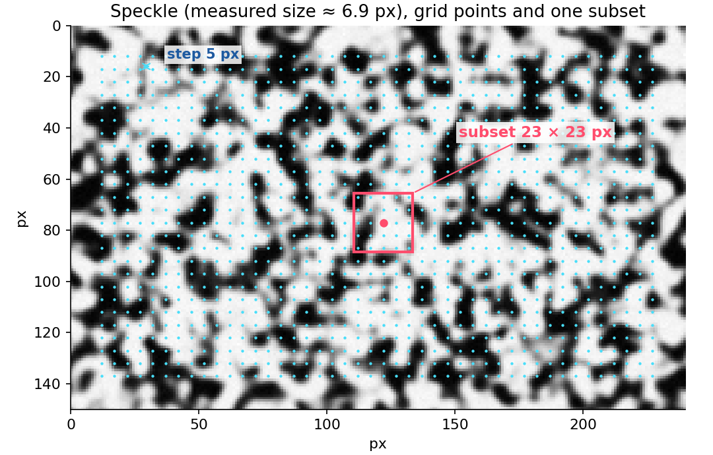
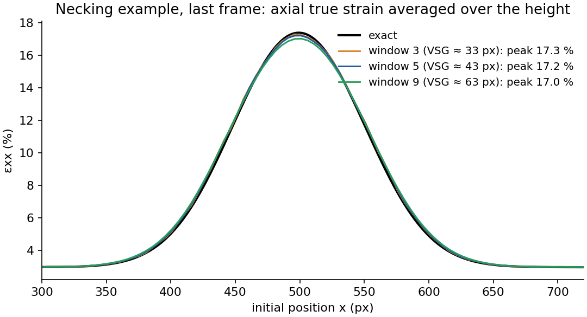

# Theory

This page explains what Moby-DIC computes and why each processing step exists. It follows the
standard formulation of local (subset-based) 2D digital image correlation found in the
literature listed at the end; the notation is close to Pan et al. (2009) and Sutton, Orteu &
Schreier (2009).

## 1. Principle of 2D digital image correlation

The specimen surface carries a random, high-contrast pattern (the **speckle**), usually sprayed
paint. A camera records images while the specimen is loaded. Because the pattern deforms with the
surface, finding where each small piece of pattern went from one image to the next gives the
in-plane displacement of that piece of material. Differentiating the displacement field gives the
strain field.

2D DIC assumes that:

- the observed surface is **planar** and stays in a plane **parallel to the sensor**;
- the motion is **in-plane**; out-of-plane motion changes the magnification and appears as a
  spurious, uniform strain of about Δz/Z, where Z is the lens-to-specimen distance (1 mm of
  out-of-plane motion at Z = 500 mm produces an apparent strain of 0.2 %);
- lens distortion is negligible over the field of view (or the scale is small enough not to matter).

Under these assumptions a single scale factor (µm per pixel) converts image coordinates to
specimen coordinates. Strains are dimensionless and do **not** depend on the scale.

## 2. Coordinates and notation

Moby-DIC uses a Cartesian system with the origin at the **lower-left corner** of the image,
x to the right and y **up** (images are flipped vertically when read; this is the same convention
as muDIC). The loading direction is assumed to be x in the automatic choices, but any direction
works.

- X = (X, Y): position of a point in the **first** (undeformed) image.
- x = (x, y): position of the same material point in the current image.
- u = x − X: displacement, with components uₓ and u_y.
- f: grey levels of the reference image; g: grey levels of the current (deformed) image.

## 3. Subsets and the shape function

DIC cannot track a single pixel: one grey level is not unique. It tracks a **subset**, a square
window of (2M+1) × (2M+1) pixels centred on each measurement point. The subset is assumed to
deform according to a **first-order (affine) shape function**: a point at offset (Δx, Δy) from
the subset centre in the reference image moves to

$$x' = x_0 + \Delta x + u + u_x\,\Delta x + u_y\,\Delta y$$

$$y' = y_0 + \Delta y + v + v_x\,\Delta x + v_y\,\Delta y$$

where (u, v) is the displacement of the subset centre and uₓ = ∂u/∂x, u_y = ∂u/∂y,
vₓ = ∂v/∂x, v_y = ∂v/∂y are its displacement gradients. The six unknowns form the parameter
vector p = (u, uₓ, u_y, v, vₓ, v_y). The affine shape function captures uniform stretch, shear and
rotation inside the subset; strain gradients inside a subset are averaged out, which is one of
the reasons the subset size limits the spatial resolution.

Measurement points form a regular **grid** with spacing *step* (in pixels) inside the region of
interest (ROI) of the first image. Neighbouring subsets overlap when step < subset size, which is
normal (Moby-DIC defaults to step ≈ subset/5).

## 4. Correlation criterion: ZNSSD / ZNCC

The match between the reference subset and the deformed subset is measured by the
**zero-mean normalised sum of squared differences** (ZNSSD):

$$C_{ZNSSD}(\mathbf{p}) = \sum_{i} \left[ \frac{f(\mathbf{x}_i) - \bar{f}}{\Delta f} - \frac{g(\mathbf{x}'_i) - \bar{g}}{\Delta g} \right]^2$$

$$\Delta f = \sqrt{\sum_i \left[f(\mathbf{x}_i) - \bar{f}\right]^2}, \qquad \Delta g = \sqrt{\sum_i \left[g(\mathbf{x}'_i) - \bar{g}\right]^2}$$

where the sums run over the pixels of the subset and f̄, ḡ are the subset mean grey levels.
Subtracting the mean and dividing by the norm makes the criterion insensitive to offset and
scaling of the intensity (changes in illumination or exposure between images). ZNSSD is
equivalent to the **zero-mean normalised cross-correlation** (ZNCC):

$$ZNCC = 1 - \frac{C_{ZNSSD}}{2}$$

ZNCC = 1 is a perfect match; values above 0.95 are typical of good images. Moby-DIC reports ZNCC
for every point and frame (viewer field *Correlation quality*), accepts a point only if
ZNCC ≥ 0.8 (option `--zncc-min`) and uses ZNCC statistics to decide when to update the reference
(section 8).

## 5. Optimisation: inverse-compositional Gauss-Newton (IC-GN)

The parameters p that minimise C are found iteratively with the **inverse-compositional
Gauss-Newton** algorithm (Baker & Matthews 2004; Pan et al. 2013). Instead of linearising the
deformed image g (whose gradient changes at every iteration), IC-GN linearises the *reference*
subset: at each iteration it finds a small increment Δp of the reference warp and composes the
current warp with its inverse,

$$W(\mathbf{p}) \leftarrow W(\mathbf{p}) \circ W(\Delta\mathbf{p})^{-1}$$

The Gauss-Newton increment is

$$\Delta\mathbf{p} = -\mathbf{H}^{-1} \sum_i \left[\nabla f_i\, \frac{\partial W}{\partial \mathbf{p}}\right]^T \left[ f(\mathbf{x}_i) - \bar{f} - \frac{\Delta f}{\Delta g}\left(g(\mathbf{x}'_i) - \bar{g}\right) \right]$$

where H is the 6 × 6 Hessian built from the reference image gradients ∇f and the Jacobian of the
warp. Because both depend only on the reference subset, **H is computed once per point** and
reused in every iteration and every frame that uses the same reference, which makes IC-GN much
faster than the classical forward-additive Newton-Raphson, with identical accuracy.

Iterations stop when the increment is below 10⁻³ px, measured as
√(Δu² + Δv² + M²(Δuₓ² + Δu_y² + Δvₓ² + Δv_y²)), i.e. roughly the motion of the subset edge, or
after 50 iterations (`--maxit`). Points that do not converge, or converge with ZNCC below the threshold,
are marked as **failed** for that frame.

### Validation of each measurement

A converged solution with a high ZNCC is not always the right one. From a poor starting point the
optimiser can find a **degenerate warp** (the subset collapses onto a few pixels, with displacement
gradients near −1) or lock onto a nearby but wrong position. Moby-DIC therefore accepts a point only
if, in addition to ZNCC ≥ 0.8:

1. every displacement gradient between the reference and the current frame is below 0.5 in
   magnitude (incremental correlation never needs more);
2. its displacement agrees with its neighbours: the distance between its displacement and the
   median displacement of the measured points in the surrounding 5 × 5 grid window must be below
   2 px. Real discontinuities open gradually, so between a reference and the current frame the
   displacement field is locally smooth at this scale.

Points that fail these checks are treated like any failed point: they are retried (with the
global-jump correction or against the previous frame) and, if still inconsistent, reported as
missing. The check is applied twice, so a cluster of wrong points cannot hide its neighbours.

### Sub-pixel interpolation

The deformed positions x′ are not integers, so g must be interpolated. Moby-DIC uses **cubic
B-spline interpolation** (the image is pre-filtered once into spline coefficients). Low-order
interpolation (bilinear) causes a systematic, periodic error in the sub-pixel displacement
(the "S-shaped" bias); cubic B-splines reduce it to the level of a few thousandths of a pixel.

### Initial guess

IC-GN converges only if the initial guess is within a few pixels of the solution. For every
frame Moby-DIC predicts each point's position by extrapolating its motion from the two previous
frames. If a point does not converge, an **integer search** (ZNCC over a ±6 px window,
`--search`) gives a new starting point. If many points fail at once, the **global rigid jump**
between the reference and the current image is estimated by phase correlation of the whole ROI
(useful when the specimen or the camera suddenly moves, e.g. when a grip slips), and the failed
points are retried from the jumped position. A corrected jump is not extrapolated into the next
frame's prediction.

## 6. Accuracy of the correlation kernel

The test suite (`tests/test_sintetico.py`) deforms a synthetic speckle pattern with a known field
(translation, uniform stretch, shear and a sinusoidal displacement of 1 px amplitude) and
compares. With a 25 px subset and 5 px step the displacement error has a standard deviation of
**0.011 px** and the strain error (5-point window) of **0.05 %**. Real images add camera noise,
imperfect speckle and optical effects; a realistic noise floor for good images is 0.01–0.03 px and
0.02–0.1 % strain, which can be checked by correlating two images of the specimen at rest (see
[Good experimental practice](good-practice.md)).

## 7. Tracking large deformations: total displacements

Strains are always reported **relative to the first image** (Lagrangian description): every point
keeps its identity, X, during the whole test, and its current position x is tracked. The
displacement u = x − X is the *total* displacement.

When the deformation becomes large (several percent), a subset in the first image no longer looks
like its deformed version, ZNCC drops and correlation fails. The solution is to correlate against
a more recent image, the **updated reference**, and add the incremental displacement to the
position the point had in that reference. This is called *incremental* correlation. Each update
adds a small error (the error of the incremental measurement), so the number of updates should be
as small as the deformation allows.

## 8. Reference updating strategy

Moby-DIC offers three modes:

| Mode | Behaviour | Use |
|---|---|---|
| **Automatic** (default) | The reference is updated only when the correlation with it degrades: median ZNCC < 0.98, or 5th-percentile ZNCC < 0.95, or more than 0.3 % of points fail (`--zncc-ref`, `--zncc-ref-p05`, `--fail-ref`). | almost always |
| Every N frames | The reference is updated at a fixed interval (`--reference-every N`). | reproducing other software, muDIC |
| Fixed | Always the first image. | small strains (≲ 2 %), maximum accuracy |

When an update is triggered, the new reference is the **last good frame** (a frame where at least
50 % of the points were measured, `--min-fraction`); a bad frame never becomes a reference. The
subsets of the new reference are centred on the current positions of the points, and the frame is
correlated again against it.

### Lost points

A point can fail in one frame (glare, a scratch, a crack opening, the subset leaving the
specimen). Its position in that frame is then **estimated** from the measured neighbours by a
normalised Gaussian convolution on the grid (the radius grows until every point is covered), so
that it can be tracked again in the next frame. Estimated values are *never* reported as
measurements: they are flagged invalid (`valido = False`) and appear as holes in the maps.

### Rescue against the previous frame

If some points still fail against the reference, they are correlated against the **last good
frame**, which is closer in deformation than the reference, and the result is chained to that
frame's measured positions. This removes most of the scattered losses that otherwise appear just
before a reference update (`--no-rescue` disables it).

### Sharpness matching (refocusing)

Changes in focus during the test (refocusing the lens, the specimen moving out of the depth of
field, necking surfaces tilting) change the image *texture*, not only its intensity, which
normalisation cannot correct. Moby-DIC measures the sharpness of each image as the mean squared
Laplacian of the ROI,

$$S = \left\langle \left( \nabla^2 I \right)^2 \right\rangle_{ROI}$$

and, when the reference and current images differ in sharpness by more than 1.5×, blurs the
sharper one with a Gaussian filter whose σ is chosen (by bisection) to make both sharpness values
equal before correlating again. If the sharpness of the sequence varies by more than 3×, this
matching is applied to every frame automatically (`--match-sharpness`).

## 9. From displacements to strains

### Local plane fit (strain window)

Differentiating noisy displacements directly would amplify the noise. Moby-DIC fits, for each
grid point, a plane to the **total** displacements of the w × w neighbouring points (the
*strain window*, default w = 5) by least squares:

$$u(\Delta X, \Delta Y) \approx a_0 + a_1\,\Delta X + a_2\,\Delta Y, \qquad v(\Delta X, \Delta Y) \approx b_0 + b_1\,\Delta X + b_2\,\Delta Y$$

where ΔX, ΔY are the initial offsets of the neighbours. The slopes are the components of the
displacement gradient, which gives the **deformation gradient**

$$\mathbf{F} = \mathbf{I} + \nabla_X \mathbf{u}: \qquad F_{11} = 1 + a_1, \quad F_{12} = a_2, \quad F_{21} = b_1, \quad F_{22} = 1 + b_2$$

Only measured neighbours enter the fit, and the strain of a point is computed only when at least
60 % of its window was measured, so holes in the displacement field do not create artefacts.

### Strain measures

From the right Cauchy-Green tensor C = FᵀF, Moby-DIC reports the **true (logarithmic) strain** of
material fibres initially along x and y, and the shear strain:

$$\varepsilon_{xx} = \frac{1}{2}\ln C_{11}, \qquad \varepsilon_{yy} = \frac{1}{2}\ln C_{22}, \qquad \varepsilon_{xy} = \frac{1}{2}\arcsin\frac{C_{12}}{\sqrt{C_{11}\,C_{22}}}$$

ε_xx is ln(ℓ/ℓ₀) of a fibre initially along x, i.e. the true strain used in plasticity; for small
strains it reduces to ∂u/∂x. ε_xy is half the change of the angle between the x and y fibres (the
tensor shear strain; the engineering shear strain is γ_xy = 2 ε_xy). The local **rigid rotation**
is

$$\omega = \arctan \frac{F_{21} - F_{12}}{F_{11} + F_{22}}$$

These four quantities are stored in `campos.npz`; the viewer derives the others.

### Derived quantities (viewer)

| Field | Definition | Notes |
|---|---|---|
| Principal strains ε₁, ε₂ | eigenvalues of the 2D strain tensor | ε₁ ≥ ε₂ |
| Maximum shear | (ε₁ − ε₂)/2 | |
| Von Mises equivalent strain | below | assumes plastic incompressibility, ε_zz = −(ε_xx + ε_yy) |
| Area change | ε_xx + ε_yy | ln of the area ratio (in-plane dilatation) |
| Contraction ratio | −ε_yy/ε_xx | "apparent Poisson's ratio"; noisy when ε_xx ≈ 0 |
| Plastic anisotropy r (Lankford) | ε_yy/ε_zz | meaningful in the plastic range of sheet specimens |
| Increments Δε | value in frame t minus frame t−1 | where the deformation is *currently* concentrating |

$$\varepsilon_{eq} = \sqrt{\frac{2}{3}\left(\varepsilon_{xx}^2 + \varepsilon_{yy}^2 + \varepsilon_{zz}^2 + 2\,\varepsilon_{xy}^2\right)}$$

### Spatial resolution

A strain value is an average over the region that influenced it: the subsets of all the points in
the strain window. Its size, the **virtual strain gauge** (VSG), is approximately

$$L_{VSG} \approx \mathrm{subset} + (w - 1)\cdot\mathrm{step}$$

With the defaults (subset 25 px, step 5 px, w = 5) the VSG is 45 px. Strain features smaller than
the VSG (a sharp neck, a crack tip, a thin layer) are smoothed: their peak is underestimated and
they look wider. Larger VSGs reduce noise; smaller VSGs resolve finer features. The interface
shows the VSG of the chosen parameters in the *Method and grid* step.

The figure above uses the *necking* example (tutorial 1), whose exact peak true strain in the last
frame is 17.4 %: a 3-point window resolves it closely but is noisier, a 9-point window is smooth
but underestimates the peak.

## 10. Automatic parameter choices

| Parameter | Rule | Rationale |
|---|---|---|
| Speckle size | 2 × the radius at which the image autocorrelation (central part of the ROI) falls to 0.5 | average dot diameter |
| Subset | ≈ 3.25 × speckle size, odd, between 15 and 61 px | ≥ 3 speckles across the subset for a unique, well-conditioned match |
| Step | ≈ subset / 5 | dense grid without excessive redundancy |
| Strain window | 5 points | compromise between noise and resolution |
| ROI | specimen edges (bright painted band on a darker background, detected in ~8 frames across the sequence), minus a margin of max(20, subset/2 + 8) px, and 10 % of the width at each side | subsets must stay on the specimen during the whole test; room for the motion along x |
| Sharpness matching | on if the sharpness of the sequence varies > 3× | refocusing or out-of-plane motion |
| Frame selection | all images, or one every N when there are more than 300 (≈ 250 frames) | keeps run time reasonable |

All automatic values can be overridden in the interface or on the command line.

## 11. Optional muDIC backend (global DIC)

When the `muDIC` package is installed, Moby-DIC can run **global (finite-element) DIC**
(Olufsen et al. 2020): the displacement field of the whole ROI is described by a mesh (bilinear
Q4 elements or a single B-spline surface) and all nodal displacements are solved together.
Global DIC enforces continuity between elements, which can help with poor speckle, but the strain
is constant (Q4) or very smooth (B-spline) per element, the reference can only be updated every
N frames and there is no point recovery or sharpness matching. The subset method is recommended
for most uses.

## References

1. M. A. Sutton, J.-J. Orteu, H. W. Schreier. *Image Correlation for Shape, Motion and Deformation
   Measurements*. Springer, 2009.
2. B. Pan, K. Qian, H. Xie, A. Asundi. Two-dimensional digital image correlation for in-plane
   displacement and strain measurement: a review. *Measurement Science and Technology* 20,
   062001, 2009.
3. B. Pan, K. Li, W. Tong. Fast, robust and accurate digital image correlation calculation
   without redundant computations. *Experimental Mechanics* 53, 1277–1289, 2013.
4. S. Baker, I. Matthews. Lucas-Kanade 20 years on: a unifying framework. *International Journal
   of Computer Vision* 56, 221–255, 2004.
5. J. Blaber, B. Adair, A. Antoniou. Ncorr: open-source 2D digital image correlation Matlab
   software. *Experimental Mechanics* 55, 1105–1122, 2015.
6. P. L. Reu et al. (eds.). *A Good Practices Guide for Digital Image Correlation*. International
   Digital Image Correlation Society (iDICs), 2018. doi:10.32720/idics/gpg.ed1
7. S. N. Olufsen, M. E. Andersen, E. Fagerholt. µDIC: an open-source toolkit for digital image
   correlation. *SoftwareX* 11, 100391, 2020.
8. H. W. Schreier, J. R. Braasch, M. A. Sutton. Systematic errors in digital image correlation
   caused by intensity interpolation. *Optical Engineering* 39, 2915–2921, 2000.
