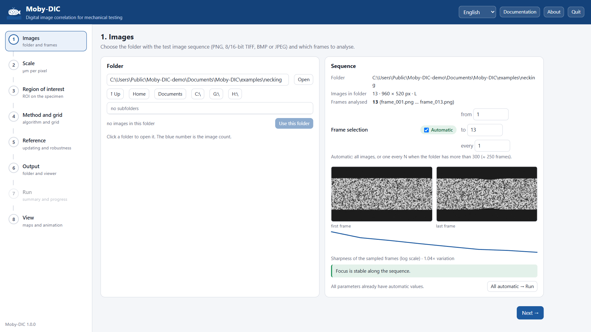
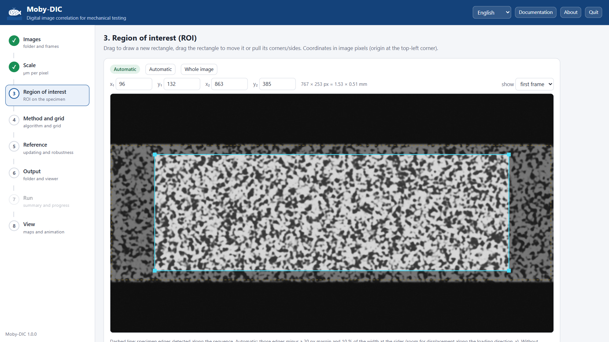
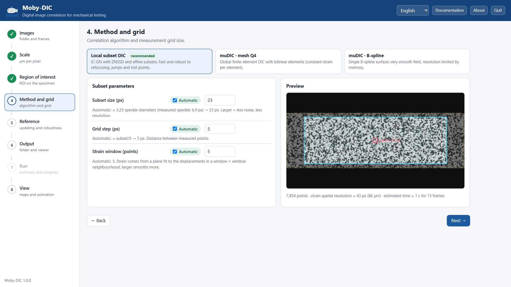
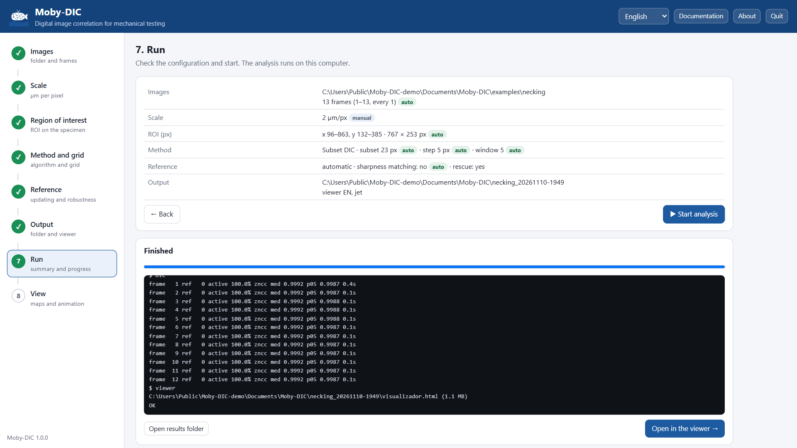
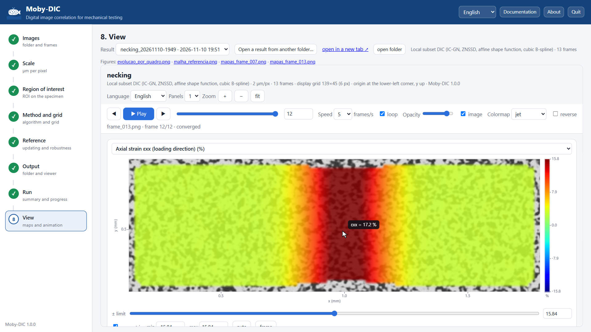

# Tutorial 1 · First analysis: tension with necking

This tutorial runs a complete analysis with the **necking** example, a synthetic sequence that
Moby-DIC generates itself, so it works without any images of your own. It takes about five
minutes. A narrated video of the same steps, `Moby-DIC-tutorial.mp4` (with English subtitles in
`Moby-DIC-tutorial.srt`), is in the program folder:

<video controls preload="none" width="100%" src="/tutorial.mp4" poster="../img/welcome.png">Open
<code>Moby-DIC-tutorial.mp4</code> in the program folder.</video>

## The example

Thirteen images of 960 × 520 px of a painted, speckled specimen (the bright horizontal band) on a
dark background, loaded in tension along x. The exact displacement field imposed on the images is

- a uniform background strain growing from 0 to 3 %;
- a Gaussian strain concentration (a **neck**) at x ≈ 500 px, 70 px wide, growing to an additional
  16 %, so the peak true strain in the last frame is **ln(1.19) = 17.4 %**;
- lateral contraction of half the axial strain (plastic incompressibility);
- a rigid slip of the grip of 4 px along x over the test;
- camera noise (σ = 1.6 grey levels).

The exact field is written to `ground_truth.json` next to the images, so the result can be
checked (see [Tutorial 4](04-python-post-processing.md)).

## 1. Open the example

Start Moby-DIC. On the very first start, choose the language and then **Try an example**; this
generates the dataset and opens it. Otherwise, in step **1 · Images** click
**▶ Tension with localized necking** in the *Try an example* card.

The images are written to `Documents\Moby-DIC\examples\necking`, and Moby-DIC analyses the
sequence: 13 frames, a stable focus, and the specimen edges.

## 2. Scale

The synthetic images have no physical scale; choose **Enter value** and type `2` (µm/px), so that
displacements are reported in micrometres. Strains do not depend on this value.

## 3. Region of interest

The automatic ROI (cyan) sits inside the detected specimen edges (yellow, dashed), with margins at
the top and bottom so that subsets never leave the specimen, and 10 % of the width removed at each
side. Switch the preview to the **last frame** to see that the specimen has become narrower at the
neck and the ROI is still on the speckle.

## 4. Method and grid

Keep **Local subset DIC**. Moby-DIC measured the speckle size (about 6.9 px) and chose the subset
(23 px) and the grid step (5 px); the preview shows the grid and one subset in red. The line under
the preview reads about 7 900 points and a **strain spatial resolution of 43 px**: strain features
narrower than about 43 px will be smoothed. The neck (70 px wide) is wider than that, so it will be
resolved, with a slight underestimate of its peak.

## 5–6. Reference and output

Keep the automatic reference updating and the default output (working folder
`Documents\Moby-DIC`, name `necking_<date-time>`).

## 7. Run

Check the summary and click **▶ Start analysis**. The log prints one line per frame: the
reference used, the fraction of active points and the median and 5th-percentile ZNCC. With this
example ZNCC stays above 0.99 and the first image remains the reference for the whole test. The
analysis takes a few seconds (plus ~30 s the very first time, while the kernel is compiled).

## 8. View the results

Click **Open in the viewer →**.

Things to try:

1. Select **Axial strain εxx** and press **▶ Play**: the neck appears in the middle of the
   specimen and concentrates the strain as the test progresses.
2. Hover over the centre of the neck in the last frame: εxx ≈ 17.2 %, against the exact 17.4 %.
   The 1 % relative difference is the smoothing of the 43 px virtual strain gauge
   ([Theory § 9](../theory.md#spatial-resolution)).
3. Choose **2 panels** and show **Transverse strain εyy** next to εxx: εyy ≈ −εxx/2 everywhere, as
   imposed. The **Contraction ratio** field is ≈ 0.5 wherever the strain is well above the noise.
4. Show **Axial strain increment Δεxx**: in the last frames all the new deformation happens in the
   neck, while the rest of the specimen barely deforms.
5. Show **Horizontal displacement uₓ**: the 4 px grip slip appears as a uniform offset, which does
   not affect the strains.
6. Export the current figure as PNG, or record a video of the εxx animation.

## What you learned

- The automatic choices (ROI, subset, step, reference) are usually a good starting point.
- The **strain spatial resolution** reported in step 4 tells you the size of the smallest feature
  you can resolve; compare it with the features you expect (necks, bands, layers).
- Displacements include rigid motion; strains do not.

Next: [Tutorial 2](02-layered-specimen.md) uses derived fields to tell two materials apart.
