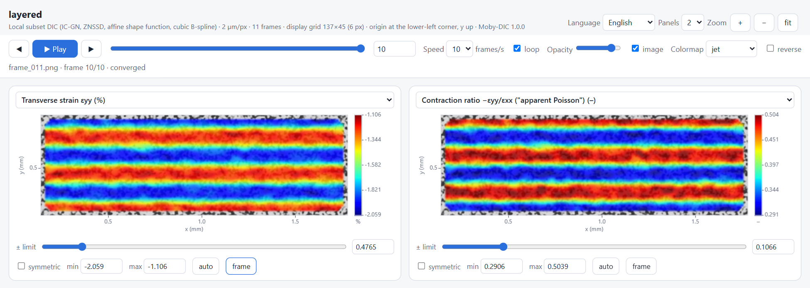

# Tutorial 2 · Layered specimen: telling materials apart

Heterogeneous specimens (laminates, welds, coatings, composites, graded materials) are where
full-field measurements pay off. This tutorial uses the **layered** example: a specimen made of
horizontal layers, parallel to the loading direction, of two materials with different contraction
ratios.

## The example

- Layers 50 px thick, alternating material A (contraction ratio ν = 0.30) and material B
  (ν = 0.48), starting at the lower edge of the specimen.
- Uniform axial strain εxx growing to 4 % (with layers parallel to the load, all layers stretch
  equally: an **iso-strain** configuration).
- Each layer contracts laterally according to its own ratio: in the last frame the exact
  transverse true strains are εyy = −1.21 % in A and −1.94 % in B.

Because the axial strain is the same in every layer, the εxx map is uniform and does not reveal
the layers. The difference is in the **transverse** response.

## Run the analysis

In step 1, open **▶ Layered specimen, layers parallel to the load**. Use a scale of 2 µm/px and
keep everything else automatic (or use **All automatic → Run**).

> The layers are 50 px thick and the automatic strain spatial resolution is 43 px (subset 23 px,
> step 5 px, window 5), comparable to the layer thickness. Strain is averaged across layer interfaces over that distance, so the plateaus
> of each layer will be narrower than the layer and the transitions smooth. For a real laminate,
> choose a subset, step and window such that subset + (window − 1) × step is well below the
> thinnest layer.

## Read the result

1. **Axial strain εxx** — uniform, 3.9 % (ln 1.04 = 3.92 %) in the last frame.
2. **Transverse strain εyy** — horizontal stripes: −1.22 % in A layers and −1.93 % in B layers
   (exact −1.21 % and −1.94 %). Untick *symmetric* and press *frame* to stretch the colour scale.
3. **Contraction ratio −εyy/εxx** — the clearest picture of the two materials: 0.31 in A and
   0.49 in B (exact: 0.308 and 0.494). (Because these are true strains, the ratio of logarithms differs slightly from
   the imposed engineering ratio.)
4. **Area change εxx + εyy** — larger in the low-ν material A.
5. **Shear strain εxy** stays near zero: the layers deform without sliding relative to each other.

Hover over the maps, or export the frame, to read the values. To get a **through-thickness
profile** (average along x of each grid row), see [Tutorial 4](04-python-post-processing.md#profiles-across-layers).

## Fields worth checking in real heterogeneous specimens

| Question | Field |
|---|---|
| Do the phases deform differently in the transverse direction? | εyy, contraction ratio |
| Is there strain partitioning along the load? (layers *perpendicular* to the load) | εxx, profiles along x |
| Are interfaces sliding or shearing? | εxy, maximum shear, rotation ω |
| Where does plasticity start and localise? | Δεeq increments, εeq |
| Sheet anisotropy per phase | plastic anisotropy r (plastic range only) |
| Is any region poorly measured (debonding, cracks, paint loss)? | ZNCC, holes in the maps |

Next: [Tutorial 3](03-difficult-sequences.md) shows how Moby-DIC copes with imperfect images.
