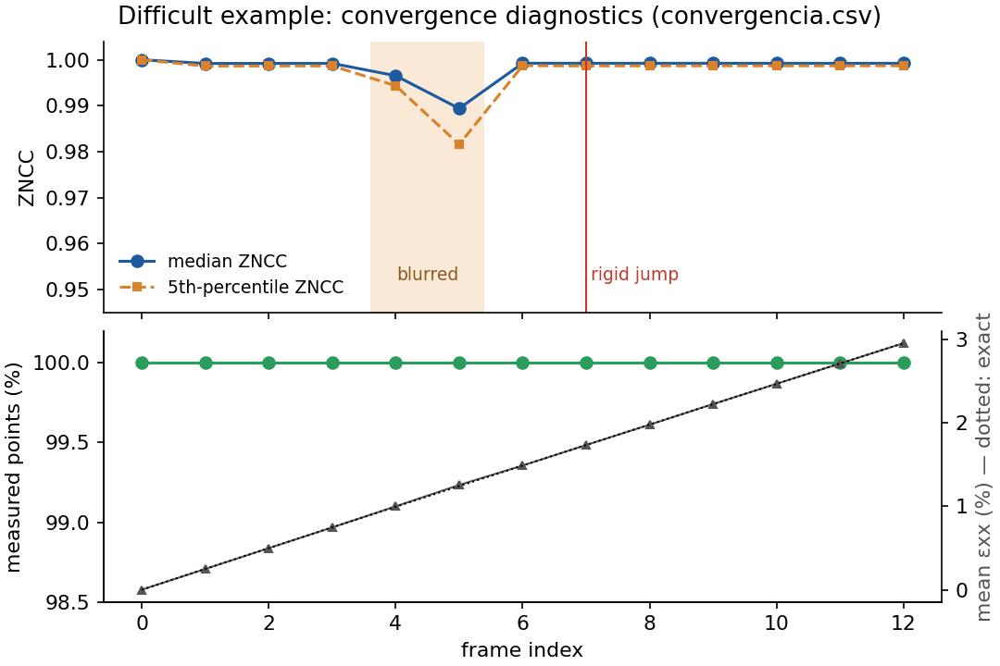

# Tutorial 3 · Difficult sequences: refocusing and rigid jumps

Real tests are rarely perfect: the operator refocuses the lens, the specimen moves out of the depth
of field, a grip slips and the whole specimen jumps between two images. This tutorial uses the
**difficult** example to show what Moby-DIC does in those cases and how to check that it worked.

## The example

Uniform tension up to 3 % (contraction ratio 0.33), 13 frames, with two problems:

- frames 5 and 6 (indices 4 and 5) are **out of focus** (Gaussian blur σ = 1.6 and 2.2 px);
- from frame 8 (index 7) on, the specimen is displaced by a **rigid jump** of 14 px in x and
  4.2 px in y, far beyond the convergence radius of the correlation.

## Run the analysis

Open **▶ Refocusing and a rigid jump during the test**, use a scale of 2 µm/px and run with the
automatic settings.

In step 1 the sharpness curve shows the drop at the blurred frames: the sharpness varies 5.9×
along the sequence, above the 3× threshold, so a warning appears and **sharpness matching** is
switched on automatically in step 5.

## What happens during the run

The log and `convergencia.csv` tell the story (frame indices start at 0):

| Index | Reference | What happened |
|---|---|---|
| 1–3 | 0 | normal, median ZNCC 0.999 |
| 4, 5 (blurred) | 0 | the sharp reference is blurred to the sharpness of the current frame (σ = 1.24 and 1.54 px, column `sigma_igualacao_px`, negative = reference filtered); median ZNCC stays at 0.997 and 0.989, so no reference update is needed |
| 6 | 0 | sharp again, ZNCC 0.999 |
| 7 (jump) | 0 | almost every point fails at first. The **global jump** between the reference and this frame is estimated by phase correlation, ≈ (+14, +4.2) px, the imposed jump, and the points are retried from the jumped position. A few points that had locked onto a wrong position in the first attempt disagree with their neighbours and are retried too ([false-match rejection](../theory.md#validation-of-each-measurement)). Result: 100 % measured |
| 8–12 | 0 | normal; the jump is not extrapolated into the next prediction |

The first image remains the reference for the whole test, at least 99.9 % of the points are valid
in every frame, and the mean axial strain differs from the exact ln(1 + e) by at most **0.014 %**
strain.

Without sharpness matching (untick it in step 5 to compare), Moby-DIC updates the reference at the
blurred frames instead: the correlation still succeeds, at the cost of a few reference updates.

## How to check your own difficult sequences

1. **Run log / `convergencia.csv`**: look at `fracao_ativa` (active fraction), `zncc_mediana`,
   `zncc_p05` and `referencia`. Reference updates should be few; a frame with a very low active
   fraction is flagged `quadro_ruim` (bad frame) and never used as a reference.
2. **Viewer, Correlation quality (ZNCC)** field: blurred frames show uniformly lower ZNCC; local
   problems (glare, paint loss) show as spots.
3. **Viewer, εxx animation**: a rigid jump or refocus that was not handled appears as a sudden,
   uniform strain change or as a frame full of holes. Here the strain evolves smoothly.
4. If a few frames are hopeless (motion blur, flash), exclude them by changing the frame selection,
   or drop the last frames after fracture with `--until-frame` in the viewer.

## What you learned

- Focus changes are compensated by sharpness matching, which is enabled automatically when the
  focus of the sequence varies strongly.
- Sudden rigid motions are recovered by the global-jump search, and wrong matches are rejected by
  the neighbour-consistency check.
- Losses are never hidden: points that are not measured stay marked invalid.

Next: [Tutorial 4](04-python-post-processing.md) reads the results in Python and compares them
with the exact solution.
