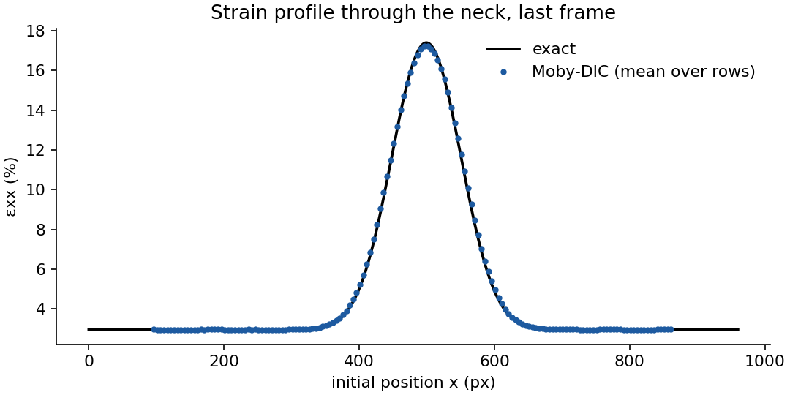
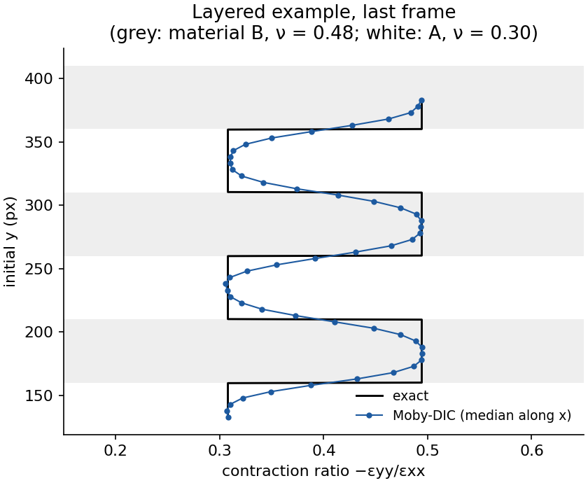

# Tutorial 4 · Post-processing in Python

The viewer covers most needs, but publications often require custom plots: strain profiles,
averages over a gauge, comparisons with simulations or with an extensometer. All fields are in
`campos.npz`, a standard NumPy archive. This tutorial uses the results of tutorials 1 and 2.

Requirements: Python with NumPy and Matplotlib (a source installation of Moby-DIC already has
them). The complete script is `docs/examples/necking_profile.py`.

## Load a result

```python
import json
import numpy as np

res = "Documents/Moby-DIC/necking_20261110-1530"           # your result folder
with np.load(f"{res}/campos.npz") as z:
    d = {k: z[k] for k in z.files}

valid = d["valido"]                      # [frame, row, col] bool
exx = d["deformacao_xx"]                 # true strain (not %)
X0 = d["centro_xy_px"][0, ..., 0]        # initial x of each point, px
print(exx.shape, d["arquivos"][-1])
```

Always use `valid` as a mask: values of points that were not measured are not data.

## Strain profile along the specimen, compared with the exact solution

The necking example stores its exact field in `ground_truth.json`. Average εxx over the height of
the ROI (the rows of the grid), frame by frame, and plot it against the initial position x:

```python
import matplotlib.pyplot as plt

gt = json.load(open("Documents/Moby-DIC/examples/necking/ground_truth.json"))
t = len(exx) - 1                                             # last frame
prof = np.nanmean(np.where(valid[t], exx[t], np.nan), axis=0)   # mean over rows
x = X0[0]                                                    # x of each column, px

e0, a, xc, s = gt["e0"][t], gt["a"][t], gt["xc_px"], gt["s_px"]
exato = np.log1p(e0 + a * np.exp(-((x - xc) / s) ** 2))      # exact true strain

plt.plot(x, 100 * exato, "k-", label="exact")
plt.plot(x, 100 * prof, "o", ms=3, label="Moby-DIC")
plt.xlabel("initial position x (px)"); plt.ylabel("εxx (%)"); plt.legend(); plt.show()
```



The measured profile follows the exact one; at the peak it is 0.2 % strain lower (17.2 % against
17.4 %) because of the 43 px virtual strain gauge.

## Virtual extensometer

A virtual extensometer gives the engineering strain between two points, like a clip-on gauge.
Pick the grid columns closest to two initial positions and use the current positions:

```python
pos = d["centro_xy_px"]                       # current positions [frame, row, col, 2]
row = pos.shape[1] // 2                       # middle row
c1, c2 = np.argmin(abs(x - 200)), np.argmin(abs(x - 800))
L0 = pos[0, row, c2, 0] - pos[0, row, c1, 0]
L = pos[:, row, c2, 0] - pos[:, row, c1, 0]
ext = L / L0 - 1                              # engineering strain of a 600 px gauge
```

(Check `valid[:, row, c1]` and `valid[:, row, c2]`; average a few rows for robustness.)

## Average over a gauge area

```python
m = valid[t] & (abs(X0 - 500) < 50)           # 100 px wide band around the neck
print("mean εxx in the band: %.2f %%" % (100 * exx[t][m].mean()))
```

## Profiles across layers

For the layered example, average along x (axis 1, columns) to get a through-thickness profile of
εyy and of the contraction ratio:

```python
with np.load("Documents/Moby-DIC/layered_20261110-1540/campos.npz") as z:
    v, eyy, exx, xy = z["valido"], z["deformacao_yy"], z["deformacao_xx"], z["centro_xy_px"]
t = len(v) - 1
Y0 = xy[0, :, 0, 1]                                            # initial y of each row
eyy_prof = np.nanmedian(np.where(v[t], eyy[t], np.nan), axis=1)
ratio = -eyy_prof / np.nanmedian(np.where(v[t], exx[t], np.nan), axis=1)
plt.plot(ratio, Y0); plt.xlabel("−εyy/εxx"); plt.ylabel("initial y (px)")
```



## Exporting to other tools

```python
import csv
with open("profile.csv", "w", newline="") as f:
    w = csv.writer(f); w.writerow(["x_px", "exx_pct"])
    w.writerows(zip(x, 100 * prof))
```

For MATLAB, `scipy.io.savemat("campos.mat", d)` writes the same arrays to a `.mat` file. The CSV
tables in the result folder (`campos_por_ponto.csv`, `resumo_por_quadro.csv`) can be opened
directly in Excel, Origin or similar programs.
