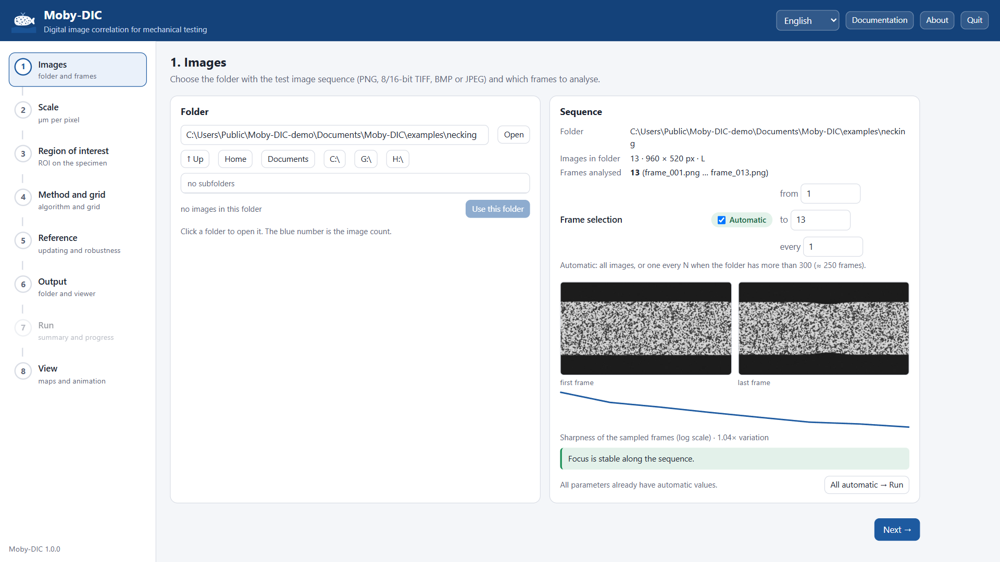

# User guide

The interface is a sequence of eight steps shown on the left as a flowchart. A step turns green
when it is done; you can go back to any step at any time. Each parameter shows a green
**Automatic** pill when its value comes from Moby-DIC's own analysis of your images; untick it to
type your own value.

The top bar holds the language selector, **Documentation** (this manual), **About** and **Quit**.

## Before you start: the images

Moby-DIC reads a folder containing the image sequence of one test, in PNG, TIFF (8 or 16 bit), BMP
or JPEG, grey-level or colour (colour is converted to grey). Images are sorted in natural order
(`img_2` before `img_10`), so any consistent numbering works. All images must have the same size.

Prefer lossless formats (PNG, TIFF). JPEG compression creates block artefacts that bias the
correlation.

## 1. Images

Browse to the folder and click **Use this folder**. The folder list shows, in blue, how many images
each subfolder contains, and marks folders that already contain a Moby-DIC result.

Moby-DIC then analyses a sample of the sequence (about eight images spread over the test) and
reports:

- image size and bit depth, and how many frames will be analysed;
- thumbnails of the first and last frames;
- a **sharpness curve** over the sequence. If the focus varies by more than 3× (refocusing, the
  specimen moving out of the depth of field), a warning appears and sharpness matching is enabled
  automatically (step 5).

**Frame selection.** By default all images are analysed, or one every N when the folder has more
than 300 images (≈ 250 frames). Untick *Automatic* to choose the first image, the last image and
the interval. Analysing every image is rarely necessary: the strain changes little between
consecutive images of a slow test, and the run time is proportional to the number of frames.

**All automatic → Run** skips straight to step 7 with every value automatic.

No images at hand? The card **Try an example** generates one of the synthetic datasets used in the
tutorials.

## 2. Scale

The scale converts pixels to micrometres and should come from a calibration of your set-up: an
image of a ruler or a calibration target placed in the plane of the specimen surface. Divide the
known length (µm) by its length in the image (px).

- **Last value used** — the scale of your previous analysis.
- **Enter value** — µm per pixel, e.g. `1.76`.
- **Uncalibrated** — displacements and axes are reported in pixels. Strains are not affected.

You can reprocess later with the correct scale; nothing else changes.

## 3. Region of interest (ROI)

The ROI is the rectangle, in the **first** image, where the measurement grid is placed.

- The yellow dashed line shows the specimen edges detected along the sequence.
- **Automatic**: those edges minus a margin, and 10 % of the width removed at each side to leave
  room for the motion along the loading direction (x). If no specimen/background contrast is
  found, the whole image minus the margins is used.
- Drag in the image to draw a new rectangle, drag inside it to move it, or pull its sides and
  corners. You can also type the corner coordinates (pixels, origin at the top-left corner of the
  image as displayed).
- Show the **last frame** to check that the ROI stays on the specimen until the end of the test.

Keep the ROI on the speckled surface. Points whose subsets leave the specimen, or fall on grips,
edges or text, fail and appear as holes.

## 4. Method and grid

**Local subset DIC** (recommended) — see [Theory](theory.md) for the algorithm.

| Parameter | Automatic value | Effect |
|---|---|---|
| Subset size (px) | ≈ 3.25 × measured speckle size, odd, 15–61 px | larger: less noise, better convergence, coarser resolution |
| Grid step (px) | ≈ subset / 5 | distance between measured points; smaller = more points, longer run |
| Strain window (points) | 5 | number of grid points (w × w) used in the plane fit for strain; larger = smoother |

The preview draws the grid and one subset on the image, and the line below gives the number of
points, the **strain spatial resolution** (virtual strain gauge ≈ subset + (window − 1) × step) and
an estimate of the run time.

**muDIC · Q4 / B-spline** (only when the optional `muDIC` package is installed): global
finite-element DIC. Element size for Q4 (≈ subset + 5 px), number of control points for B-spline.

## 5. Reference and robustness

| Mode | When to use |
|---|---|
| **Automatic** (recommended) | Updates the reference only when the correlation degrades. Works for small and large strains. |
| Every N frames | Fixed interval (the only option for muDIC). |
| Fixed at the first frame | Small strains (≲ 2 %): no accumulated error. |

Options (subset method):

- **Match sharpness on every frame** — automatic: on when the sharpness varies more than 3×.
  Frames that fail because of a focus change get this treatment even when it is off.
- **Rescue lost points** — points that fail against the reference are correlated against the
  previous good frame. Keep it on.
- **Advanced thresholds** — median ZNCC (0.98), 5th-percentile ZNCC (0.95) and failure fraction
  (0.3 %) that trigger a reference update, and the minimum ZNCC for accepting a point (0.8).
  Lowering the update thresholds means fewer updates (less accumulated error, more risk of losing
  points); raising them, the opposite.

## 6. Output

- **Working folder** — each analysis creates a subfolder here (default `Documents\Moby-DIC`).
- **Analysis name** — automatic: `<image folder>_<date-time>`. The folder must not exist yet.
- **Viewer initial language** and **initial colormap** — both can be changed later in the viewer.

## 7. Run

The summary lists every value and whether it is automatic or manual. **Start analysis** runs the
correlation on this computer; the progress bar and the log show each frame with its reference,
fraction of active points and ZNCC statistics. **Cancel** stops the run (the partial folder is
kept).

At the end, the viewer is generated and you can **Open results folder** or **Open in the viewer**.
Typical times on an 8-core laptop: ~0.1–0.5 s per frame for 5 000–20 000 points.

## 8. View

The built-in [viewer](viewer.md) shows the selected result. The menu lists every result produced
here or in the working folder; **Open a result from another folder** adds an existing result
folder (if it has `campos.npz` but no viewer, the viewer is generated). **Open in a new tab** shows
the viewer full-screen, and the static figures (PNG) are linked above it.

## Language

The language chosen at the first start applies to the interface, the run log, the figures and the
viewer. Change it at any time with the selector in the top bar; results already generated keep
their figure language, but their viewer switches language on its own page.
