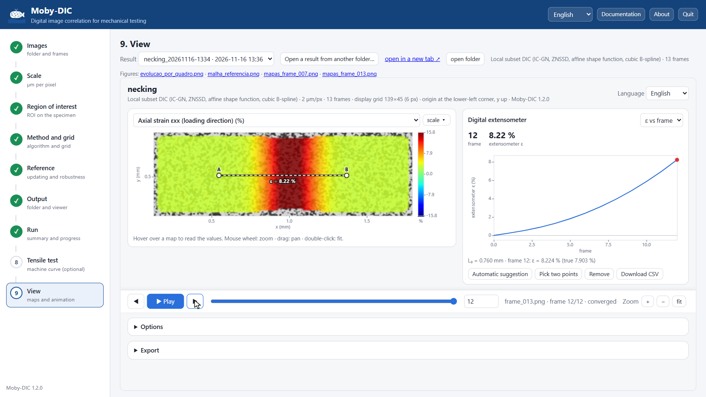

# Interactive viewer

Every result folder contains `visualizador.html`, a single self-contained file (typically 2–30 MB)
with the images, the fields and the viewer code. It opens in any recent browser, works offline and
can be shared by e-mail or placed next to a paper's supplementary data. The same viewer is embedded
in step 9 of the application.



## Layout and navigation

- **Specimen and curve**: the map of the chosen field over the specimen image (left) and the
  extensometer chart (right), with the time, stress and strain of the current frame on top of the
  chart. Choose the field in the menu above the map; the **scale ▾** button next to it opens the
  colour-scale controls of that map.
- **Timeline** (bar below): ◀ ▶ and **▶ Play** (space bar), slider, frame number, file name, zoom.
- **Options** (collapsible): number of map panels (1 = specimen + curve; 2 or 4 to compare fields
  side by side, with the chart below), colormap, opacity, background image, playback speed and loop,
  and the extensometer gauge definition.
- **Export** (collapsible): figure, image series, video.
- **Zoom**: mouse wheel over a map, drag to pan, double-click (or **fit**) to show the whole
  region; the buttons + / − and the keys + − 0 do the same. Zoom is synchronised between panels.
- **Opacity**: blend between the field and the grey-level image underneath.
- Hovering over a map shows the value under the cursor, and the line below the map the values of
  all the displayed fields.
- **Language**: English / Português (labels, titles and exported figures).

Maps are drawn on the **deformed configuration**: each value sits where the material point is in
the current image.

## Fields

| Group | Field | Unit |
|---|---|---|
| Displacements | Horizontal displacement uₓ (loading direction), vertical displacement u_y, magnitude \|u\| | µm (px if uncalibrated) |
| Strains | Axial strain εxx, transverse strain εyy, shear strain εxy (true strains) | % |
| Derived quantities | Major and minor principal strains ε₁, ε₂; maximum shear (ε₁ − ε₂)/2; von Mises equivalent strain εeq; area change εxx + εyy; contraction ratio −εyy/εxx; plastic anisotropy r = εyy/εzz; local rotation ω | %, –, ° |
| Frame-to-frame increments | Δεxx, Δεyy, Δεeq between the current and the previous frame | % |
| Measurement quality | Correlation quality ZNCC (1 = perfect) | – |

Definitions are given in [Theory § 9](theory.md#9-from-displacements-to-strains). Points that were
not measured in a frame are transparent.

Tips:

- **Increments** show where the deformation is concentrating *now*: the onset of necking or of a
  shear band appears in Δεeq well before it is obvious in the total strain.
- **Contraction ratio** and **r** are ratios: they are meaningless where εxx is near zero (early
  frames, elastic range with noise). Read them where the strain is well above the noise level.
- **ZNCC** maps reveal where the speckle is poor, out of focus or damaged.

## Digital extensometer

The **Digital extensometer** panel below the maps measures the strain between two material points,
like a clip-on extensometer, over the whole test.

- **Automatic suggestion** (applied when the viewer opens): a line along the loading direction x,
  on the grid row closest to the centre that is measured in (almost) every frame, spanning the
  middle half of the measured width.
- **Pick two points**: the initial frame is selected; click point A and then point B on any map.
  Points must lie inside the region measured in the initial frame.
- **Gauge definition** (Options → *Extensometer: gauge definition*): L₀, centre x and y (axis
  units, origin at the lower-left corner) and a **band in y** that averages parallel gauge lines
  (spacing = grid step) to reduce noise. The values of the automatic or picked gauge are shown there;
  editing L₀ or the centre keeps the gauge direction. Typing the same numbers on another result
  reproduces the same gauge.
- **Measure**: L (distance between the points), or only its x or y component.
- The two points are tracked as **material points** with the measured displacement field (bilinear
  interpolation of the DIC grid), so the gauge follows the specimen. The plot shows the engineering
  strain ε = L/L₀ − 1 against the frame number, or against time when the frames were extracted from a
  video; the summary line gives L₀, ε and the true strain ln(L/L₀) at the current frame.
- The gauge is drawn on every panel with its current value, and is included in exported figures,
  image series and videos.
- **Download CSV**: frame, file, time, L, engineering and true strain (and load and stress when
  correlated with the test), with the point coordinates, L₀ and band in the header.

> **The strain of a virtual extensometer depends on its length and position** once the
> deformation is not uniform (layered materials, necking, shear bands), exactly as for a physical
> extensometer. Before localisation the dependence is small; after it, the strain grows as L₀
> shrinks around the neck. Always report L₀ and the position (they are in the CSV header), and use
> the same definition to compare specimens. The field of view limits L₀: standard gauge lengths for
> elongation at fracture (e.g. 5.65√S₀) are usually longer than the field of a microscope-scale
> setup, so such values are local strains, not standard elongations.

When the result was correlated with the tensile test (step 8 of the application), the **Chart**
menu offers:

- **stress vs ε (test)** — the stress–strain curve: machine stress (or load) against the
  extensometer strain, with the current frame marked;
- **test curve vs time** — the whole machine curve, the time span of the images (green), the
  fracture (dashed) and the analysed frames;
- **stress vs crosshead position** — the whole machine curve against the crosshead position (mm),
  the analysed frames on it and the current frame marked (offered when the curve has a position
  column; *load vs crosshead position* when it has no stress). It needs no extensometer, so it also
  works where DIC measured few points. The crosshead position includes the machine compliance and
  is not the specimen strain;
- **ε vs time** — extensometer strain against the test time.

The frame line above the maps and the exported figures then show the test time, the stress and the
crosshead position of the current frame, and the extensometer CSV includes the load, the stress and
the crosshead position. The figure and video export (layout 1) put the chosen chart next to the
specimen; the two machine-curve charts are exported even without an extensometer.

Results correlated with Moby-DIC 1.2 have no position in the reduced machine curve: the position
chart then shows only the analysed frames. Run step 8 (or `moby-dic tensile`) again to get the whole
curve.

A long gauge gives the average (global) strain, comparable with a mechanical extensometer; a short
gauge across a neck or a band gives the local strain there. Frames where one of the points is not
measured are left as gaps.

## Colour scales

For each panel:

- **auto** — limits from all frames (robust percentiles), so colours mean the same thing in every
  frame of the animation;
- **frame** — limits from the current frame only;
- **min / max** — type values, or drag the slider; **symmetric** keeps the scale centred on zero
  (default for signed quantities);
- **Colormap** — jet, white-jet, turbo, viridis, plasma, inferno, magma, cividis, coolwarm, RdBu_r,
  seismic, bwr, gray, with **reverse**. Perceptually uniform maps (viridis, cividis) are preferable
  for publications and for readers with colour-vision deficiency.

## Export

- **Figure of the current frame** — PNG of the visible panels at the chosen resolution, with or
  without title, using the current scales, colormaps and language.
- **Frames as images (ZIP)** — a range of frames (from, to, step) as PNG or JPEG.
- **Animation (video)** — records the frames in real time at the chosen speed. MP4 is offered by
  Chrome and Edge; other browsers record WebM. Keep the tab visible while recording.

Static figures generated during the analysis (`mapas_*.png`, `evolucao_por_quadro.png`,
`malha_referencia.png`) are in the result folder.

## Rebuilding a viewer

To change the frame range, the display resolution or the default language/colormap of an existing
result:

```bash
moby-dic viewer RESULT_FOLDER --lang en --cmap viridis --until-frame 120
```

See [Command line](command-line.md#viewer).
