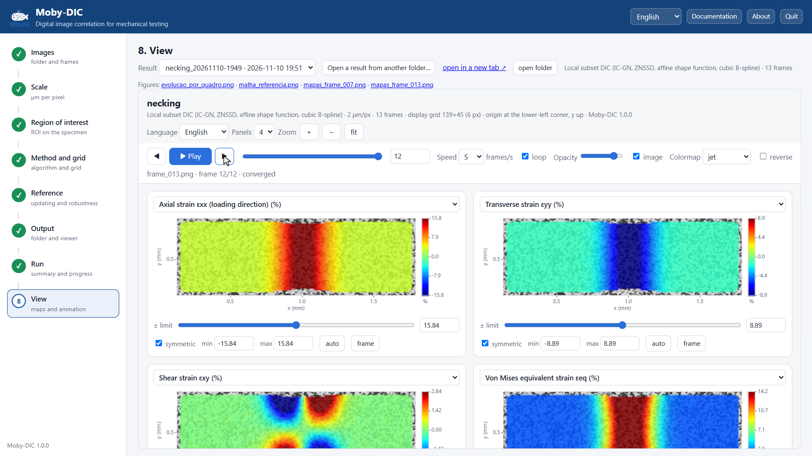

# Interactive viewer

Every result folder contains `visualizador.html`, a single self-contained file (typically 2–30 MB)
with the images, the fields and the viewer code. It opens in any recent browser, works offline and
can be shared by e-mail or placed next to a paper's supplementary data. The same viewer is embedded
in step 8 of the application.



## Layout and navigation

- **Panels**: 1, 2 or 4 maps side by side, each with its own field, colour scale and colormap.
- **Frame**: slider, ← / → keys, or **▶ Play** (space bar) with adjustable speed (frames/s) and
  loop.
- **Zoom**: mouse wheel over a map, drag to pan, double-click (or **fit**) to show the whole
  region; the buttons + / − and the keys + − 0 do the same. Zoom is synchronised between panels.
- **Opacity**: blend between the field and the grey-level image underneath.
- Hovering over a map shows the values of all the displayed fields at that point.
- **Language**: English / Português (labels, titles and exported figures).

Maps are drawn on the **deformed configuration**: each value sits where the material point is in
the current image.

## Fields

| Group | Field | Unit |
|---|---|---|
| Displacements | Horizontal displacement uₓ (loading direction), vertical displacement u_y, magnitude \|u\| | µm (px if uncalibrated) |
| Strains | Axial strain εxx, transverse strain εyy, shear strain εxy (true strains) | % |
| Derived quantities | Major and minor principal strains ε₁, ε₂; maximum shear (ε₁ − ε₂)/2; von Mises equivalent strain εeq; area change εxx + εyy; contraction ratio −εyy/εxx; plastic anisotropy r = εyy/εzz; local rotation ω | %, –, ° |
| Frame-to-frame increments | Δεxx, Δεyy, Δεeq between the current and the previous frame | % |
| Measurement quality | Correlation quality ZNCC (1 = perfect) | – |

Definitions are given in [Theory § 9](theory.md#9-from-displacements-to-strains). Points that were
not measured in a frame are transparent.

Tips:

- **Increments** show where the deformation is concentrating *now*: the onset of necking or of a
  shear band appears in Δεeq well before it is obvious in the total strain.
- **Contraction ratio** and **r** are ratios: they are meaningless where εxx is near zero (early
  frames, elastic range with noise). Read them where the strain is well above the noise level.
- **ZNCC** maps reveal where the speckle is poor, out of focus or damaged.

## Colour scales

For each panel:

- **auto** — limits from all frames (robust percentiles), so colours mean the same thing in every
  frame of the animation;
- **frame** — limits from the current frame only;
- **min / max** — type values, or drag the slider; **symmetric** keeps the scale centred on zero
  (default for signed quantities);
- **Colormap** — jet, white-jet, turbo, viridis, plasma, inferno, magma, cividis, coolwarm, RdBu_r,
  seismic, bwr, gray, with **reverse**. Perceptually uniform maps (viridis, cividis) are preferable
  for publications and for readers with colour-vision deficiency.

## Export

- **Figure of the current frame** — PNG of the visible panels at the chosen resolution, with or
  without title, using the current scales, colormaps and language.
- **Frames as images (ZIP)** — a range of frames (from, to, step) as PNG or JPEG.
- **Animation (video)** — records the frames in real time at the chosen speed. MP4 is offered by
  Chrome and Edge; other browsers record WebM. Keep the tab visible while recording.

Static figures generated during the analysis (`mapas_*.png`, `evolucao_por_quadro.png`,
`malha_referencia.png`) are in the result folder.

## Rebuilding a viewer

To change the frame range, the display resolution or the default language/colormap of an existing
result:

```bash
moby-dic viewer RESULT_FOLDER --lang en --cmap viridis --until-frame 120
```

See [Command line](command-line.md#viewer).
